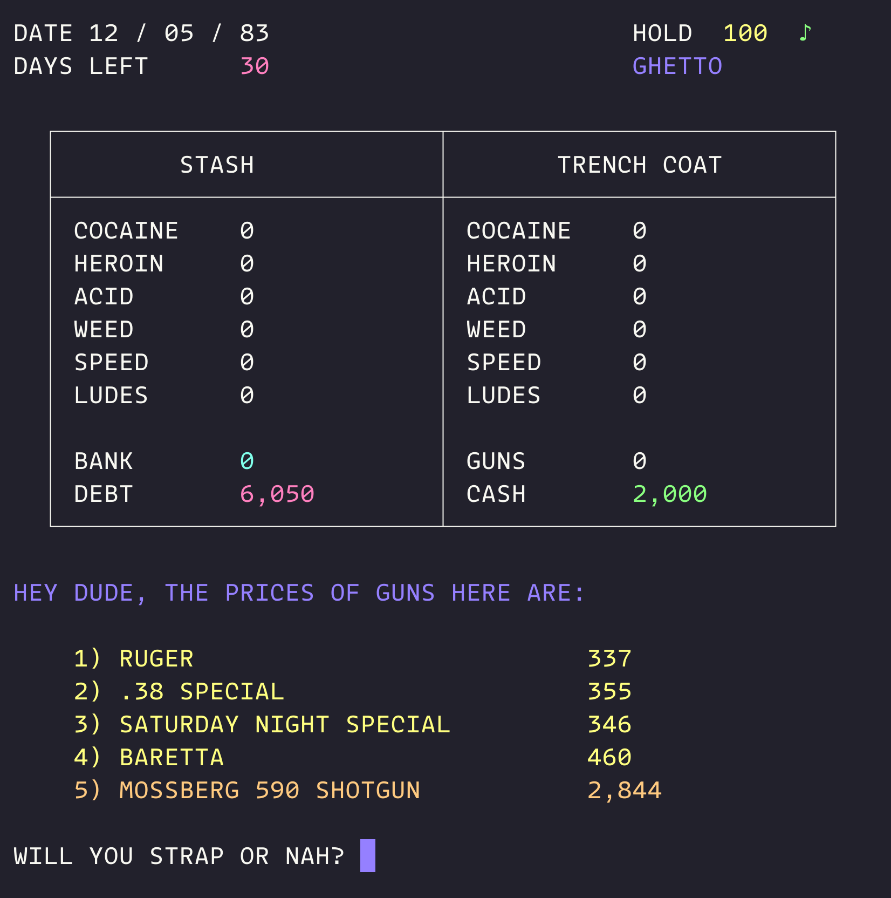

# drugwars-rust

Drugwars for the terminal, rebuilt in Rust 🦀

By urrick hunt

Current version: `0.6.69`

This started from the same game idea, but it is no longer a straight port. The codebase has been completely refactored and the game itself has been expanded with music, a revised gun system, shotgun combat, stronger validation, better feedback, and a more readable small screen text flow.

<p align="center">
  
</p>

## Highlights

- Complete refactor from a monolithic single file game into a modular Rust
  project with separate rules, UI, model, flow, and view layers.
- Optional background music, when a supported player is available, with `M` /
  `m` toggle support at the `BUY / SELL / JET` prompt.
- New ANSI title presentation with a logo splash screen and typewriter style
  intro/instructions screens.
- Revised weapon system: up to two handguns, with better fight odds when
  carrying two, plus a shotgun upgrade with its own combat behavior.
- Guns are no longer random daily events; they are sold in the Ghetto as a
  dedicated market encounter.
- Context-aware positive and negative messages throughout trading, bank, loan,
  stash, combat, and event flows.
- Amount prompts are stricter and clearer: non-numeric input is ignored,
  oversized numbers no longer collapse to `0`, and failed actions return to
  the same field with a clear message.
- Buy screens show both what you can afford and, when relevant, what you can
  still carry.
- Event and confirmation text is split more cleanly for smaller terminal
  screens.
- High scores are stored in a per-user app data directory instead of the
  current working directory or binary folder.
- Color-coded market events, drug price swings, and clearer outcome messaging.

## Audio

- Music uses `mpv` if available, then falls back to `ffplay`.
- If no supported player is installed, the game still runs normally; music is simply disabled.
- Windows example: install `mpv` with Scoop via `scoop install mpv`.
- macOS example: install `mpv` with Homebrew via `brew install mpv`.
- macOS: install `mpv` or `ffplay` and make sure it is on `PATH`.
- Linux: install `mpv` or `ffplay` from your distro packages and make sure it is on `PATH`.

## Controls

- `Y` / `N` for confirmations.
- At the `BUY / SELL / JET` prompt: `B` buy, `S` sell, `J` jet, `M` toggle music.
- The HUD music note shows as a green `♪` when music is playing and a grey
  `♪` when it is off, paused, or unavailable.
- Drug keys are prompt-based: `C` cocaine, `H` heroin, `A` acid, `W` weed, `S` speed, `L` ludes.
- Travel uses `1` through `6`.

## Install

```bash
cargo install drugwars-rust
drugwars-rust
```

## Run

```bash
cargo run --release
```

Standard release build:

```bash
cargo build --release
./target/release/drugwars-rust
```

## LTO Release Build

```bash
cargo run --profile release-lto
```

or build the binary directly:

```bash
cargo build --profile release-lto
./target/release-lto/drugwars-rust
```

On Windows Git Bash / mintty, run the built executable through `winpty`:

```bash
winpty ./target/release/drugwars-rust.exe
winpty ./target/release-lto/drugwars-rust.exe
```

If `drugwars-rust.exe` is already on your `PATH`, this also works:

```bash
winpty drugwars-rust
```

## Version

```bash
cargo run -- --version
```

## High Scores

- Linux: `$XDG_DATA_HOME/drugwars-rust/highscores.txt` or `~/.local/share/drugwars-rust/highscores.txt`
- macOS: `~/Library/Application Support/drugwars-rust/highscores.txt`
- Windows: `%APPDATA%\drugwars-rust\highscores.txt`

## Lint and Test

```bash
cargo test
cargo clippy -- -W clippy::pedantic -W clippy::nursery -W clippy::cargo
```

For crate tests, use `crate::test_support::game_builder()` to build focused
`GameState` fixtures instead of wiring the internals by hand:

```rust
let game = crate::test_support::game_builder()
    .with_cash(10_000)
    .with_price(Drug::Cocaine, 20_000)
    .with_cops(3)
    .build();
```

## Platforms

- macOS
- Linux
- Windows

## License

MIT
